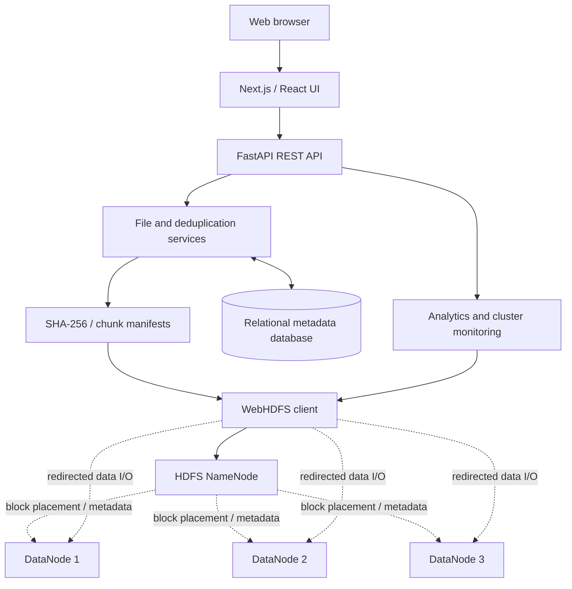
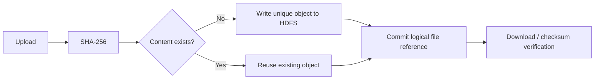

<div align="center">

# HDFS Optimizer

### Store unique content. Preserve every byte. Understand every replica.

**An HDFS-backed storage optimization platform combining content-aware deduplication, verified file recovery, cluster observability, and an interactive web experience.**

<p>
  
  
  
  
  
</p>

[Explore the system](#the-system-at-a-glance) · [Architecture](#system-architecture) · [Quick start](#quick-start) · [Validation](#testing-and-verification) · [Benchmarks](#benchmarking-and-storage-metrics) · [Project report](#academic-deliverables)

</div>

---

## The idea

Hadoop Distributed File System (HDFS) is designed to store data across multiple DataNodes and protect it using **intentional block replication**. But two independently uploaded files with identical contents can still occupy redundant logical storage.

**HDFS Optimizer addresses that second problem.** It identifies repeated file content, stores reusable data objects, maintains logical file references, and reconstructs files with cryptographic integrity checks. A browser-based interface makes storage behavior, optimization jobs, and cluster state easier to inspect.

> [!IMPORTANT]
> **Replication is not duplication.** HDFS replicas exist for fault tolerance and must not be removed as a deduplication shortcut. This project's deduplication logic operates at the application-content layer; HDFS remains responsible for its own block placement and replication.

## The system at a glance

| Capability | What it does |
| :-- | :-- |
| **Whole-file deduplication** | Uses SHA-256 to identify files with identical byte content—even when names differ. |
| **Chunk-level content reuse** | Indexes application-managed chunks and reuses previously stored content where supported. |
| **Content-addressable storage** | Separates logical file names from stored data objects and their references. |
| **Byte-exact restore** | Rebuilds file contents in the original order and verifies the resulting checksum. |
| **HDFS replication visibility** | Surfaces cluster topology, replication settings, and available health information. |
| **Storage analytics** | Compares logical content size with unique content retained and explains storage savings. |
| **Experiment-driven evaluation** | Uses authentic source documents, reproducible workloads, and measured results. |
| **Full-stack dashboard** | Brings files, duplicates, jobs, experiments, and monitoring into one interface. |

### Inside the application

| Workspace | Purpose |
| :-- | :-- |
| **Overview** | High-level storage metrics, optimization summary, recent activity, and cluster health. |
| **File explorer** | Browse logical files, inspect metadata, and access file operations. |
| **Duplicate analysis** | Investigate exact matches and shared-content relationships. |
| **Optimization center** | Review and execute safe, observable optimization workflows. |
| **Replication & monitoring** | Explore the HDFS cluster and supported replication controls. |
| **Analytics & activity** | Review measured trends, job history, and audit information. |
| **Dataset lab** | Inspect corpus provenance and run reproducible experiments. |

<!-- SCREENSHOT INTEGRATION:
     Add authentic images only after checking the exact paths in this repository.
     Suggested layout:

     <p align="center">
       
     </p>
     <p align="center"><em>Live application dashboard, captured from a real project run.</em></p>

     For additional screenshots, prefer a compact 2-column table and link to
     full-size originals. Never substitute fabricated dashboards for execution evidence.
-->

## System architecture

The interface communicates with the Python API. The API coordinates file metadata, content hashing, deduplication, integrity checks, and HDFS operations through WebHDFS.



**Design boundaries**

- **HDFS** stores and replicates data; the NameNode manages filesystem metadata and DataNodes store HDFS blocks.
- **The application** identifies reusable user content and maintains the logical file-to-content mapping.
- **The metadata database** maintains logical files, content identifiers, manifests, and operation history.
- **SHA-256** provides content identification and post-restore integrity verification; it does not replace HDFS's own fault-tolerance mechanisms.

> A multi-DataNode cluster running inside one local container VM demonstrates HDFS protocols and block replication, but it does **not** provide failure isolation across physical hosts.

## How deduplication works

### 01 — Whole-file deduplication

1. Stream the uploaded file and compute its SHA-256 digest.
2. Look up its content identity in the managed index.
3. Store a new content object only when the bytes are not already represented.
4. Add a logical file record that references the stored object.
5. Restore or download the file using that reference and verify the original digest.



**Illustrative example:** `report-original.txt` and `report-copy.txt` can remain two separate visible files while referring to one stored content object if their bytes are identical. This is an explanation of behavior, **not a benchmark measurement**.

### 02 — Chunk-level deduplication

In chunk mode, the application splits content into deterministic chunks, hashes each chunk, and records the chunk sequence in a manifest. Repeated chunks can be referenced instead of stored again.

This is **application-level chunking**, not direct modification or deduplication of HDFS's internal blocks. Chunk size, manifest overhead, and the HDFS small-file problem affect the practical savings of this approach.

### 03 — Safe restoration and deletion

The system must preserve every referenced content object until it is no longer needed. Restoration follows a file manifest or object reference, reconstructs the original byte stream, and compares SHA-256 with the recorded original digest.

**Key invariant:** deleting one logical filename must never break a different logical file that references the same underlying bytes.

## Technology stack

| Layer | Technologies |
| :-- | :-- |
| **Web application** | Next.js · React · TypeScript · Tailwind CSS |
| **API & processing** | Python · FastAPI · SHA-256 hashing |
| **Distributed storage** | Apache Hadoop HDFS · WebHDFS |
| **Metadata** | SQLAlchemy · SQLite / relational database |
| **Local infrastructure** | Docker Compose · Apple Silicon-compatible HDFS environment |
| **Verification** | Pytest · HDFS integration tests · Playwright browser tests |
| **Documentation** | Technical report · diagrams · benchmark artifacts · presentation |

Exact dependencies and versions should be taken from the package manifests and lockfiles in this repository.

## Quick start

### Prerequisites

- Git
- Docker-compatible container runtime (Docker Desktop or Docker CLI with Colima)
- Python and Node.js versions compatible with the checked-in dependency manifests
- Sufficient free disk space for HDFS container volumes and the dataset

> [!NOTE]
> These are **standard entry-point commands for the described repository layout**, not a substitute for verifying the current `docker-compose.yml`, package scripts, and backend application path. Adjust the three commands below if the implementation uses different names.

**1. Clone**

```bash
git clone https://github.com/YOUR_USERNAME/hdfs-distributed-storage-optimizer.git
cd hdfs-distributed-storage-optimizer
```

**2. Start HDFS**

```bash
docker compose up -d
# Verify the actual service names and mounts in docker-compose.yml
docker compose ps
```

**3. Start the API**

```bash
cd backend
python3 -m venv .venv
source .venv/bin/activate
pip install -r requirements.txt
uvicorn app.main:app --reload
```

**4. Start the web application in another terminal**

```bash
cd frontend
npm install
npm run dev
```

**5. Open the interfaces**

| Interface | Typical local address |
| :-- | :-- |
| Frontend | `http://localhost:3000` |
| FastAPI OpenAPI documentation | `http://localhost:8000/docs` |
| HDFS NameNode web UI | `http://localhost:9870` |

The HDFS UI address depends on the Compose port mapping, and WebHDFS redirects must be reachable from the backend environment. Check the repository's configuration rather than assuming these ports are always exposed.

### Environment and local security

Keep all runtime-specific values in environment variables. Use the repository's `.env.example` as the starting point when available. Never commit API keys, database credentials, local `.env` files, HDFS data volumes, or personal files.

When developing on macOS with Colima, check that the container VM has enough memory and storage space. Use a resource-constrained configuration if included in the repository; a requested replication factor must not exceed what the running DataNodes can satisfy.

## Benchmarking and storage metrics

Evaluation should compare baseline logical content against the set of unique objects or chunks actually retained after deduplication.

| Metric | Definition |
| :-- | :-- |
| **Logical bytes** | Total bytes across all logical input files. |
| **Unique content bytes** | Bytes in retained unique content objects/chunks, excluding separate metadata overhead. |
| **Logical bytes avoided** | `logical_bytes - unique_content_bytes` for a comparable evaluated workload. |
| **Content reduction** | `(logical_bytes - unique_content_bytes) / logical_bytes × 100%` when logical bytes > 0. |
| **Deduplication ratio** | `logical_bytes / unique_content_bytes` when unique bytes > 0. |
| **Recovery success** | Restored files whose SHA-256 matches the recorded source hash. |

**Important:** logical content savings are **not** identical to physical disk-space savings. Replication, HDFS block allocation, small files, metadata, caching, asynchronous deletion, and shared container-VM storage all affect physical measurements.

### Evaluation scenarios

| Scenario | What it examines |
| :-- | :-- |
| Unique documents | Baseline cost without deliberate repetition. |
| Exact copies | Whether identical source bytes reuse stored content. |
| Shared-content workloads | How chunk reuse and manifest overhead affect storage. |
| Variable chunk sizes | Trade-offs between content reuse and metadata/object overhead. |
| Restore and verify | Byte-for-byte correctness after optimization. |
| Failure and recovery | Response to interrupted operations or HDFS service failures. |

<!-- VERIFIED BENCHMARK RESULTS:
     Insert a compact table/chart only after reading the committed result JSON/CSV.
     Suggested columns: scenario, logical size, retained unique size,
     content reduction, upload/restore time, checksum result.
     Never replace actual measurements with hypothetical percentages.
-->

## Testing and verification

The test strategy separates fast tests that can use a controlled local-filesystem adapter from integration tests that exercise **real HDFS**. Browser tests verify the frontend and its interaction with the backend.

| Level | Coverage focus |
| :-- | :-- |
| **Unit tests** | Hashes, manifests, reference semantics, validation, and storage calculations. |
| **HDFS integration tests** | Real reads/writes, replication convergence, deduplication, and reconstruction. |
| **Browser tests** | Navigation, loading states, overflow/responsiveness, file operations, and user workflows. |
| **Integrity checks** | SHA-256 agreement between original and downloaded/restored bytes. |
| **Failure tests** | Interrupted operations, service unavailability, recovery, and consistency. |

The development log reported **126 unit tests**, **17 HDFS integration tests** (repeated across three runs), and **13 browser tests** passing. These are historical development-run results, **not a continuously verified CI status**. Re-run the suites against the final commit and attach current logs before citing these as release results.

Some useful checks, subject to the actual repository layout:

```bash
# Python tests
cd backend
python -m pytest -q

# Frontend production build
cd ../frontend
npm run build

# HDFS health inspection, where Hadoop CLI is configured
hdfs dfsadmin -report
hdfs fsck / -files -blocks -locations
```

## Authentic dataset and provenance

The project uses genuine text documents from **[Project Gutenberg](https://www.gutenberg.org/)** for reproducible input workloads, rather than generating a fictitious source dataset.

Example source catalogs include:

- [Pride and Prejudice — eBook #1342](https://www.gutenberg.org/ebooks/1342)
- [Alice's Adventures in Wonderland — eBook #11](https://www.gutenberg.org/ebooks/11)
- [The Adventures of Sherlock Holmes — eBook #1661](https://www.gutenberg.org/ebooks/1661)

Development records describe an evaluation corpus of **15 original documents**. The authoritative list of exact downloaded filenames, source URLs, sizes, and hashes should come from the committed provenance manifest.

Exact copies of downloaded originals may be used as a **controlled duplicate-detection workload**; those copies must never be represented as independently sourced originals.

For automated acquisition, use Project Gutenberg's approved [robot/harvest or mirror access](https://www.gutenberg.org/policy/robot_access.html), not unrestricted automated scraping of the main website. Review applicable [usage and copyright terms](https://www.gutenberg.org/policy/terms_of_use.html), especially outside the United States.

## Deployment models

| Mode | Purpose | HDFS availability |
| :-- | :-- | :-- |
| **Local full-stack** | Run the real web application, API, metadata store, and HDFS cluster. | Real local HDFS |
| **Persistent hosted deployment** | Operate FastAPI and HDFS on suitable persistent infrastructure. | Real external HDFS, if configured |
| **Vercel showcase** | Publicly demonstrate the frontend and clearly labeled recorded/demo workflows. | **Not** hosted on Vercel itself |

Vercel is a suitable place for the Next.js presentation layer, but not for the long-lived NameNode/DataNode cluster. Any showcase must distinguish **recorded experimental results** from **simulated interactions** and must not claim that demo uploads are being stored in live HDFS unless a real backend is connected.

<!-- When deployment exists, insert a verified public URL here. -->

## Repository orientation

A conventional layout for this project is shown below. **Check this against the actual checked-in tree and rename paths before publishing.**

```text
.
├── frontend/              # Next.js dashboard
├── backend/               # FastAPI and storage services
├── infrastructure/        # Hadoop/container configuration (if separated)
├── datasets/              # Download scripts and provenance metadata
├── benchmarks/            # Experiment runners and measured artifacts
├── screenshots/           # Genuine application and execution evidence
├── diagrams/              # Architecture diagrams
├── documentation/         # Technical documentation and viva material
├── reports/               # Academic report source / final PDF
├── presentation/          # Slide source / final PPTX
├── scripts/               # Setup and verification commands
├── tests/                 # Shared or end-to-end tests
└── docker-compose.yml     # Local cluster orchestration
```

## Academic deliverables

The academic submission is designed to include the **complete PDF report** and a presentation covering the problem, objectives, dataset provenance, architecture, methodology, code, execution screenshots, output evidence, result analysis, limitations, and conclusions.

Before adding download links, verify the exact final filenames and commit them or attach the larger artifacts to a GitHub Release. Keep research/benchmark evidence consistent across the README, report, and slides.

## Known engineering considerations

- **Application chunks vs HDFS blocks:** these are different layers and have different performance characteristics.
- **HDFS small-file overhead:** storing too many tiny chunks independently can increase NameNode metadata pressure and reduce effective efficiency.
- **Distributed consistency:** database commits and HDFS operations are not one atomic transaction; staged writes, recovery, and orphan cleanup matter.
- **Replication convergence:** immediately after a write or replication change, actual block locations may take time to converge.
- **Storage accounting:** VM disks shared across multiple DataNode containers can make aggregated capacity reports misleading.
- **Single-host fault tolerance:** three containers on one laptop do not provide protection against failure of the laptop itself.
- **Security:** local demonstration defaults must be hardened before exposing a writable API or Hadoop services publicly.

## Further reading

- [Apache Hadoop — HDFS User Guide](https://hadoop.apache.org/docs/current/hadoop-project-dist/hadoop-hdfs/HdfsUserGuide.html)
- [Apache Hadoop — WebHDFS REST API](https://hadoop.apache.org/docs/current/hadoop-project-dist/hadoop-hdfs/WebHDFS.html)
- [Apache Hadoop — HDFS Architecture](https://hadoop.apache.org/docs/current/hadoop-project-dist/hadoop-hdfs/HdfsDesign.html)
- [Project Gutenberg — Robot Access Policy](https://www.gutenberg.org/policy/robot_access.html)

## Contributing and license

Issues and technical feedback are welcome. Before accepting outside contributions, document the project's review and testing process.

**License:** no license is asserted here until a valid `LICENSE` file is added. Unless a license is explicitly provided, public visibility on GitHub does not by itself grant broad rights to copy or redistribute the code.

---

<div align="center">
  <strong>HDFS Optimizer</strong><br />
  <sub>Content-aware efficiency · Distributed resilience · Verifiable recovery</sub>
</div>
